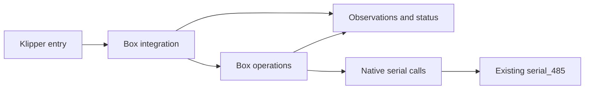

# Architecture

English | [Русский](architecture.ru.md)

**Status:** state, configuration and storage are implemented with PC tests.
The bootstrap still refuses activation; native calls and mechanical operations
remain pending.

## Scope

Replace the stock Klipper `[box]` module on a K1C with CFS Upgrade while retaining
the existing host-side `serial_485` library and CFS MCU firmware. Preserve the
touchscreen, Creality Print, Fluidd status, slicer mapping, and user settings.
The scope covers initialization, loading, unloading, cutting, tool changes and
purging, pause/resume, errors/recovery, sensors, RFID and spool data.

## Layout and responsibilities

| Path | Responsibility | Current state |
| --- | --- | --- |
| `klipper/box.py` | Thin Klipper entry point | Imports the bootstrap; refuses activation |
| `src/cfs_box/box.py` | Data composition, nine data commands, endpoint and `get_status()` | PC-tested; bootstrap refuses activation |
| `src/cfs_box/state.py` | Shared live state, snapshots, tool maps and grouping | Implemented; reply acquisition remains pending |
| `src/cfs_box/configuration.py` | Loader, UI values and MODIFY/SAVE | Implemented with explicit preservation rules |
| `src/cfs_box/storage.py` | Spool cache, recovery hints and read-only material database | Implemented; recovery lifecycle remains pending |
| `tests/test_box_contract.py` | Klipper layout and external contract checks | Bootstrap/layout check only |
| `tests/test_contract_matrix.py` | Inventory completeness and verification bindings | Validates real test references and remaining work |
| `tests/test_state.py`, `test_configuration.py`, `test_storage.py`, `test_box_data.py` | Component and data-command scenarios | Synthetic values, temporary files, bounded Klipper substitutes |
| `docs/contract-matrix.json` | Full implementation checklist and acceptance cases | Per-requirement and check-family implementation status |
| `docs/` | Architecture, protocol and compatibility, in English and Russian | Draft specifications |

Add operation and native-call modules when verified behavior needs a
separate module, together with the tests and synthetic fixtures that exercise it.
The diagram below describes logical responsibilities, not existing source files.

## Ownership and dependencies

The stock serial object owns the UART, connection lifecycle, receive path and
its internal retry behavior. The extension borrows that object through
Klipper. It must not open the port, replace native receive processing, close the
borrowed connection or introduce another transport retry loop. The available
API and its limits are tracked in the [protocol document](protocol.md#native-api).

Operations coordinate host actions with separately observed CFS, buffer and
toolhead state. An ACK, last T-command or cached material record cannot establish
physical load completion. Unknown observations remain unknown.

Retained Python modules also use specific `box` attributes and a metadata hook.
These paths are listed in the [contract matrix](contract-matrix.md) and share
the active state. Their compatibility does not require the original internal
class hierarchy. The deferred target is owned by `virtual_sdcard.resume_tnn`.

Keep waits cooperative with the Klipper reactor. Transaction timeout, operation
deadline and any verified recovery policy have separate meanings. Their concrete
values and transitions come from the target stock implementation.

## Klipper layout and Python

The planned installed layout is `klippy/extras/box.py` plus
`klippy/extras/cfs_box/`. A PC test checks this import arrangement and the explicit
refusal to activate the scaffold. No installer is provided yet.

Source targets Python 3.8 or newer, matching the preserved
native module's CPython 3.8 ABI baseline. Tests on newer PC Python versions do not
establish native ABI or printer compatibility. Tests run directly from the
checkout using standard-library `unittest`. CI runs them on Python 3.8 and 3.11
without installation or package builds. The extension is loaded by Klipper;
its source and entry point will be deployed directly by a separately verified
reversible installation procedure.

The former demonstration CLI has been removed. The project's runtime entry is
Klipper's `load_config(config)`.

## Configuration and stored data

Use the existing working configuration, including coordinates, temperature
wrappers and renamed G-code commands. Read the configured load/purge lengths;
do not turn one printer's values into global defaults. Preserve spool metadata,
material databases and slicer mappings. Persistence changes require a separately
verified format and failure policy; no new state store is introduced here.

Public source and synthetic tests belong in this layout. Originals, captures,
binary analysis and machine-specific files stay in the ignored local workspace.
The contract matrix links the approved official factory sources. Other research
references remain private at this stage.

## Implementation approach

Use the [full contract matrix](contract-matrix.md), including dependencies on
the native serial API and existing macros. For each operation,
document prerequisites, commands, observations, waits, completion and failure
paths. Implement and verify manageable parts of that contract while retaining
the full project scope. PC checks cover ordering, missing observations, timeouts
and negative replies. Hardware acceptance is a separate step requiring authorization.

Track implementation and evidence in [compatibility.md](compatibility.md).
The [implementation plan](implementation-plan.md) defines the stage order and
completion criteria for the full contract.
