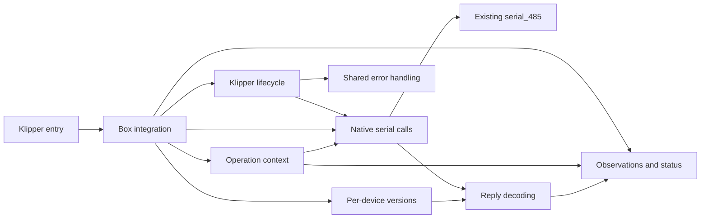

# Architecture

English | [Русский](architecture.ru.md)

**Status:** state, configuration, storage, native-call integration, reply decoding
and per-device versions are implemented with PC tests. Lifecycle, cooperative
operation context and common errors are also PC-tested. The bootstrap still
refuses activation; full mechanical and recovery procedures remain pending.

## Scope

Replace the stock Klipper `[box]` module on a K1C with CFS Upgrade while retaining
the existing host-side `serial_485` library and CFS MCU firmware. Preserve the
touchscreen, Creality Print, Fluidd status, slicer mapping, and user settings.
The scope covers initialization, loading, unloading, cutting, tool changes and
purging, pause/resume, errors/recovery, sensors, RFID and spool data.

## Layout and responsibilities

| Path | Responsibility | Current state |
| --- | --- | --- |
| `klipper/box.py` | Thin Klipper entry point | Imports the bootstrap; refuses activation |
| `src/cfs/box.py` | Shared data, endpoint, status, metadata hook and 23 functional handlers | PC-tested with substitutes; bootstrap refuses activation |
| `src/cfs/state.py` | Shared live state, snapshots, tool maps and grouping | Implemented; decoded observations share this state |
| `src/cfs/configuration.py` | Loader, UI values and MODIFY/SAVE | Implemented with explicit preservation rules |
| `src/cfs/storage.py` | Spool cache, recovery hints and read-only material database | Implemented; recovery lifecycle remains pending |
| `src/cfs/native.py` | Request bodies, reply validation and borrowed native API | Exact bodies, timeouts, sender retries and admission filters PC-tested |
| `src/cfs/protocol.py` | Command/status decoding and ordered effects | Common errors are bound; slot/refill/drain executors remain pending |
| `src/cfs/firmware.py` | Per-address identity, explicit family and exact version profiles | Mixed versions and identity invalidation PC-tested |
| `src/cfs/lifecycle.py` | Ready/shutdown, configured dependencies, reconnect, heartbeat and pause wait | Own work is removed or invalidated; borrowed transport stays with stock serial |
| `src/cfs/operations.py` | Source/target ownership, cooperative waits and head-result latch | Required phase callbacks, targeted heartbeat suspension and cancellation PC-tested |
| `src/cfs/errors.py` | Client reports, pause/restore ordering and saved error context | Duplicate/special-key behavior and caught-error exits PC-tested |
| `tests/test_box_contract.py` | Klipper layout and external contract checks | Bootstrap/layout check only |
| `tests/test_contract_matrix.py` | Inventory completeness and verification bindings | Validates real test references and remaining work |
| `tests/test_state.py`, `test_configuration.py`, `test_storage.py`, `test_box_data.py` | Component and data-command scenarios | Synthetic values, temporary files, bounded Klipper substitutes |
| `tests/test_native.py`, `test_protocol.py`, `test_firmware.py`, `test_box_native.py` | Native boundary, decoding, identity and integration scenarios | Synthetic frames, borrowed API and reactor substitutes |
| `tests/test_lifecycle.py`, `test_operations.py`, `test_errors.py` | Lifecycle, operation ownership and reporting | Controlled cooperative reactor, native replies, waits and callbacks |
| `docs/contract-matrix.json` | Full implementation checklist and acceptance cases | Per-requirement and check-family implementation status |
| `docs/` | Architecture, protocol and compatibility, in English and Russian | Draft specifications |

Add modules when implemented behavior needs them, together with its tests.
The diagram describes responsibilities; full mechanical procedures remain pending.

## Ownership and dependencies

The stock serial object owns the UART, connection lifecycle, receive path and
its internal retry behavior. The extension borrows that object through
Klipper. It must not open the port, replace native receive processing, close the
borrowed connection or introduce another transport retry loop. The adapter
preserves the recovered box-level CRC/length-status retries through that API.
The available API and its limits are tracked in the
[protocol document](protocol.md#native-api).

Native binding uses only the configured bus. Each address has its own identity
and known firmware profile; a version reply alone does not identify the hardware
family. Binding/device generations reject stale work before subsequent native
API calls and between effects. This cannot cancel retries already running inside
the stock module. Error, event and operation effects require real handlers;
missing handlers raise an error. See the [integration boundaries](protocol.md#native-integration).

Lifecycle registration precedes connect-time macro aliases. Ready resolves
configured dependencies, emits `box:ready`, then schedules an owned heartbeat.
Shutdown removes its timers and pending data callbacks and cancels operation
ownership. Stable printer event subscriptions remain gated while stopped.
Per-address identity and external family context must be current before startup;
later family/version confirmation forces initialization again. Read the
[lifecycle policies and remaining phase bindings](protocol.md#lifecycle-integration).

Operations coordinate host actions with separately observed CFS, buffer and
toolhead state. An ACK, last T-command or cached material record cannot establish
physical load completion. Unknown observations remain unknown.

Retained Python modules also use specific `box` attributes and a metadata hook.
These paths are listed in the [contract matrix](contract-matrix.md) and share
the active state. Their compatibility does not require the original internal
class hierarchy. The deferred target is owned by `virtual_sdcard.resume_tnn`.

Keep waits cooperative with the Klipper reactor. Transaction timeout, operation
deadline and any verified recovery policy have separate meanings. Their concrete
values and transitions come from the target stock implementation.

## Klipper layout and Python

The planned installed layout is `klippy/extras/box.py` plus
`klippy/extras/cfs/`. A PC test checks this import arrangement and the explicit
refusal to activate the scaffold. No installer is provided yet.

The project defaults to Python 3.8 via [.python-version](../.python-version), matching the preserved
native module's CPython 3.8 ABI baseline. Tests on newer PC Python versions do not
establish native ABI or printer compatibility. Tests run directly from the
checkout using standard-library `unittest`. CI reads the same version file and runs Python 3.8
without installation or package builds. The extension is loaded by Klipper;
its source and entry point will be deployed directly by a separately verified
reversible installation procedure.

The former demonstration CLI has been removed. The project's runtime entry is
Klipper's `load_config(config)`.

## Configuration and stored data

Use the existing working configuration, including coordinates, temperature
wrappers and renamed G-code commands. Read the configured load/purge lengths;
do not turn one printer's values into global defaults. Preserve spool metadata,
material databases and slicer mappings. Persistence changes require a separately
verified format and failure policy; no new state store is introduced here.

Public source and synthetic tests belong in this layout. Originals, captures,
binary analysis and machine-specific files stay in the ignored local workspace.
The contract matrix links the approved official factory sources. Other research
references remain private at this stage.

## Implementation approach

Use the [full contract matrix](contract-matrix.md), including dependencies on
the native serial API and existing macros. For each operation,
document prerequisites, commands, observations, waits, completion and failure
paths. Implement and verify manageable parts of that contract while retaining
the full project scope. PC checks cover ordering, missing observations, timeouts
and negative replies. Hardware acceptance is a separate step requiring authorization.

Track implementation and evidence in [compatibility.md](compatibility.md).
The [implementation plan](implementation-plan.md) defines the stage order and
completion criteria for the full contract.
