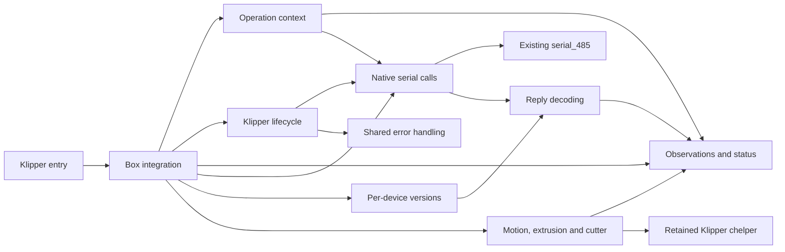

# Architecture

English | [Русский](architecture.ru.md)

The extension uses the stock `serial_485.so` in normal and passive modes. On
one K1C with CFS Upgrade and MCU 1.1.3, tool changes and two-colour jobs completed,
including pause and resume. A three-colour OrcaSlicer job completed after the
operator restored the filament. The paused tool Retry path has PC coverage and
its build started on the printer. [Compatibility](compatibility.md) separates
these checks from the remaining hardware cases.

## Scope

Replace the stock Klipper `[box]` module on a K1C with CFS Upgrade while retaining
the existing host-side `serial_485` library and CFS MCU firmware. Preserve the
touchscreen, Creality Print, Fluidd status, slicer mapping, and user settings.
The scope covers initialization, loading, unloading, cutting, tool changes and
purging, pause/resume, errors/recovery, sensors, RFID and spool data.

## Layout and responsibilities

| Path | Responsibility | Current state |
| --- | --- | --- |
| `klipper/box.py` | Thin Klipper entry point | Selects normal or passive startup |
| `src/cfs/box.py` | Shared data, endpoint, status, metadata hook and handler integration | Normal host commands and scoped diagnostic operations |
| `src/cfs/state.py` | Shared live state, snapshots, tool maps and grouping | Implemented; decoded observations share this state |
| `src/cfs/configuration.py` | Loader, UI values and MODIFY/SAVE | Implemented with explicit preservation rules |
| `src/cfs/storage.py` | Spool cache, recovery hints and read-only material database | Implemented; recovery uses validated hints |
| `src/cfs/native.py` | Request bodies, reply validation and borrowed native API | PC bodies/retry checks and bounded normal baseline API-return observations |
| `src/cfs/protocol.py` | Command/status decoding and ordered effects | PC decoding checks and baseline exchanges observed on the printer |
| `src/cfs/events.py`, `runout.py`, `recovery.py`, `resume.py` | Slot events, drain/refill, recovery and resume | Slot events and pause/resume observed on 1.1.3. PC tests cover automatic Retry and runout/refill |
| `src/cfs/firmware.py` | Per-address identity, explicit family and exact version profiles | Mixed versions and identity invalidation PC-tested |
| `src/cfs/lifecycle.py` | Ready/shutdown, configured dependencies, reconnect, heartbeat and pause wait | Own work is removed or invalidated; borrowed transport stays with stock serial |
| `src/cfs/operations.py` | Source/target ownership, cooperative waits, head-result latch and explicit trials | PC checks, T1A–T1D preload and two consecutive full T1C cycles |
| `src/cfs/print_trial.py` | One approved file, virtual-SD worker and finite callback/control scopes | PC tests cover the single-file trial in passive mode |
| `src/cfs/errors.py` | Client reports, pause/restore ordering and saved error context | Duplicate/special-key behavior and caught-error exits PC-tested |
| `src/cfs/motion.py`, `extrusion.py`, `cutting.py` | Configured motion, fans, heating, extrusion, cutting and calibration | PC checks and the verified T1C load/unload route |
| `src/cfs/feeding.py`, `loading.py`, `retraction.py` | Preload, staged loading and unloading | PC phase checks and explicit baseline preload/load/unload |
| `tests/test_box_contract.py` | Klipper layout and external contract checks | Bootstrap/layout check only |
| `tests/test_contract_matrix.py` | Inventory completeness and verification bindings | Validates real test references and remaining work |
| `tests/test_state.py`, `test_configuration.py`, `test_storage.py`, `test_box_data.py` | Component and data-command scenarios | Synthetic values, temporary files, bounded Klipper substitutes |
| `tests/test_native.py`, `test_protocol.py`, `test_firmware.py`, `test_box_native.py` | Native boundary, decoding, identity and integration scenarios | Synthetic frames, borrowed API and reactor substitutes |
| `tests/test_lifecycle.py`, `test_operations.py`, `test_errors.py` | Lifecycle, operation ownership and reporting | Controlled cooperative reactor, native replies, waits and callbacks |
| `tests/test_motion.py`, `test_extrusion.py`, `test_cutting.py`, `test_host_actions.py` | Host actions and their registration/integration | Synthetic G-code, heaters, fans, buttons and wheel replies; no hardware |
| `tests/test_material_workflow.py` | Complete service-ordered load/quit cycles | One evolving XYZ/E/source state, retained-style macro aliases, replies and injected failures |
| `tests/test_toolchange_trial.py`, `test_print_trial.py`, `test_print_integration.py` | Scoped tool changes, normal printing and paused tool Retry | Synthetic native responses, real registered handlers and retained-worker boundaries |
| `docs/contract-matrix.json` | Full implementation checklist and acceptance cases | Per-requirement and check-family implementation status |
| `docs/` | Architecture, protocol and compatibility, in English and Russian | Current behavior and validation scope |

Add modules when implemented behavior needs them, together with their tests.
The diagram shows component ownership.

## Ownership and dependencies

The stock serial object owns the UART, connection lifecycle, receive path and
its internal retry behavior. The extension borrows that object through
Klipper. It must not open the port, replace native receive processing, close the
borrowed connection or introduce another transport retry loop. The adapter
preserves the recovered box-level CRC/length-status retries through that API.
The available API and its limits are tracked in the
[protocol document](protocol.md#native-api).

Native binding uses only the configured bus. Each address has its own identity
and known firmware profile; a version reply alone does not identify the hardware
family. Binding/device generations reject stale work before subsequent native
API calls and between effects. This cannot cancel retries already running inside
the stock module. Error, event and operation effects require real handlers;
missing handlers raise an error. See the [integration boundaries](protocol.md#native-integration).

Lifecycle registration precedes connect-time macro aliases. Ready resolves
configured dependencies, emits `box:ready`, then schedules an owned heartbeat.
Shutdown removes its timers and pending data callbacks and cancels operation
ownership. Stable printer event subscriptions remain gated while stopped.
Per-address identity and external family context must be current before startup;
later family/version confirmation forces initialization again. Read the
[lifecycle policies](protocol.md#lifecycle-integration).

The production `load_config` path requires the retained `extras.base_info.base_dir`,
loads the configured `serial_485 <bus>` section through Klipper and registers the
normal lifecycle. It supplies explicit `cfs0` target context for addresses 1–4.
Optional passive startup keeps
identity/telemetry decoding and suppresses automatic preload, motor actions,
sensor toggles, pause, heating and tightening outside scoped trials. The
[installation guide](installation.md#passive-startup) lists dependencies,
data paths and the permitted read commands.

Explicit [preload](installation.md#single-operation-trial) and
[load/unload](installation.md#material-operation-trial) commands grant permission
only to the current operation while the lifecycle remains passive. The material
trial executes the configured recipe, including cleaning, flush and position
restoration. Its registered phase commands remain available independently to
retained clients. Dispatch ownership and fresh pre/postconditions bind the
selected source; an abnormal phase revokes permission before further effects.

The [tool-change trial](installation.md#tool-change-trial) uses the registered
coordinator and computed purge. A [print trial](installation.md#print-trial)
pins one file and its actual virtual-SD worker, with token-bound callback and
control scopes through pause/resume and genuine runout events. Both trials
require passive mode. The `START_PRINT` guard resolves the file's first tool
in both modes. Normal printing uses the mapped slots and the standard virtual-SD
worker. The passive print trial also verifies file and worker ownership.

For a paused virtual-SD tool load, recovery retains the open file, continuation
offset and mapped target across `BOX_ERROR_CLEAR`. Retry uses a fresh slot check
and the existing feed and purge phases. Before resuming it verifies that the head
sensor detects filament and that the completed tool matches the paused target.

Owned LOAD supplies a bounded positive flush length from configuration. Known-source
owned UNLOAD submits the finite head tail before MATERIAL and waits for it after
the normal ACK, before source cleanup and XYZ return. Two consecutive full T1C
cycles completed without manual assistance on MCU 1.1.3.

Unknown-source UNLOAD uses the existing Retraction branch without assigning a
loaded source. The requested slot pins one fresh hub lane; its current command
owns ordered reads, IDLE, shared BUFFER and selected MATERIAL, with one normal
response per step and final sensor checks.

Operations coordinate host actions with separately observed CFS, buffer and
toolhead state. An ACK, last T-command or cached material record cannot establish
physical load completion. The ordinary mode field is not the separate preload
FSM busy predicate; even ACK plus mode `0` requires independent physical
observation. Unknown observations remain unknown.

Retained Python modules also use specific `box` attributes and a metadata hook.
These paths are listed in the [contract matrix](contract-matrix.md) and share
the active state. Their compatibility does not require the original internal
class hierarchy. The deferred target is owned by `virtual_sdcard.resume_tnn`.

Keep waits cooperative with the Klipper reactor. Transaction timeout, operation
deadline and any verified recovery policy have separate meanings. Their concrete
values and transitions come from the target stock implementation.

## Klipper layout and Python

The [installer](installation.md) deploys `klippy/extras/box.py` and
`klippy/extras/cfs/` with preview, scoped backup and restore. Temporary-tree tests
cover the import layout and startup modes. It leaves other modules,
configuration, services and spool data with their owners. Commands and current
validation are described in the [installation guide](installation.md).

Python 3.8 is pinned in [.python-version](../.python-version), matching the
preserved CPython ABI baseline without establishing MIPS native compatibility.
The checkout suite uses `unittest` plus test-only Jinja2 3.1.6 from
`requirements-test.txt`; CI installs those test dependencies. Public fixtures
are synthetic. Local pinned retained-source execution is separate evidence.
The runtime entry is Klipper's `load_config(config)`. Normal operation is the
default. Set `passive: true` in `[box]` for diagnostic startup.

## Configuration and stored data

Use the existing working configuration, including coordinates, temperature
wrappers and renamed G-code commands. Read the configured load/purge lengths;
do not turn one printer's values into global defaults. Preserve spool metadata,
material databases and slicer mappings. Persistence changes require a separately
verified format and failure policy; no new state store is introduced here.

Public source and synthetic tests belong in this layout. Originals, captures,
binary analysis and machine-specific files stay in the ignored local workspace.
The contract matrix links the approved official factory sources. Other research
references remain private at this stage.

## Implementation approach

The [contract matrix](contract-matrix.md) records prerequisites, commands,
observations, completion and failure paths, including dependencies on the native
serial API and retained macros. PC checks cover ordering, missing observations,
timeouts and negative replies. The [validation plan](implementation-plan.md)
records the reference printer checks and the remaining hardware cases.
