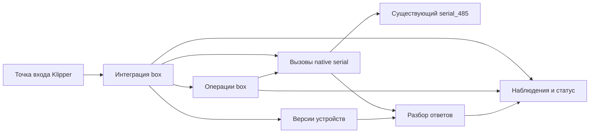

# Архитектура

[English](architecture.md) | Русский

**Статус:** состояние, настройки, хранение, интеграция native-вызовов, разбор ответов
и версии отдельных устройств реализованы с тестами на ПК. Загрузчик продолжает
отклонять активацию; интеграция жизненного цикла и механические операции ещё предстоят.

## Область работы

Заменяем штатный модуль Klipper `[box]` на K1C с CFS Upgrade, сохраняя существующую
хостовую библиотеку `serial_485` и прошивку MCU CFS. Сохраняем экран, Creality Print,
статус Fluidd, маппинг слайсера и пользовательские настройки. Объём включает
инициализацию, загрузку, выгрузку, резку, смену и продувку, паузу/продолжение,
ошибки/восстановление, датчики, RFID и данные катушек.

## Структура и ответственность

| Путь | Ответственность | Текущее состояние |
| --- | --- | --- |
| `klipper/box.py` | Тонкая точка входа Klipper | Импортирует загрузчик; активация отклоняется |
| `src/cfs_box/box.py` | Общие данные, endpoint, статус, девять обработчиков данных и двенадцать native-команд | Проверено на ПК с подстановками; загрузчик отклоняет активацию |
| `src/cfs_box/state.py` | Общее live-состояние, снимки, отображения и группировка | Реализовано; разобранные наблюдения поступают в это состояние |
| `src/cfs_box/configuration.py` | Загрузчик, UI-значения и MODIFY/SAVE | Реализовано с явными правилами сохранения |
| `src/cfs_box/storage.py` | Кэш катушек, recovery hints и чтение базы материалов | Реализовано; lifecycle восстановления ещё предстоит |
| `src/cfs_box/native.py` | Тела запросов, проверка ответов и вызовы заимствованного native API | Точные тела, таймауты, sender-повторы и фильтры допуска проверены на ПК |
| `src/cfs_box/protocol.py` | Разбор команд/статусов и упорядоченные эффекты | Проверено на ПК; при интеграции нужны обработчики операций/ошибок/событий |
| `src/cfs_box/firmware.py` | Идентичность каждого адреса, явное семейство и точные профили версий | Разные версии и сброс идентичности проверены на ПК |
| `tests/test_box_contract.py` | Размещение Klipper и проверки внешнего контракта | Только проверка загрузчика и размещения |
| `tests/test_contract_matrix.py` | Полнота перечня и связи с проверками | Проверяет реальные ссылки на тесты и оставшуюся работу |
| `tests/test_state.py`, `test_configuration.py`, `test_storage.py`, `test_box_data.py` | Сценарии компонентов и команд данных | Синтетические значения, временные файлы, ограниченные подстановки Klipper |
| `tests/test_native.py`, `test_protocol.py`, `test_firmware.py`, `test_box_native.py` | Сценарии native-границы, разбора, идентичности и интеграции | Синтетические кадры, подстановки заимствованного API и reactor |
| `docs/contract-matrix.json` | Полный перечень реализации и приёмочных сценариев | Статус реализации требований и семейств проверок |
| `docs/` | Архитектура, протокол и совместимость на двух языках | Черновые спецификации |

Модули операций выделяются, когда подтверждённому поведению нужен отдельный модуль,
вместе с проверяющими его тестами и синтетическими примерами. Диаграмма показывает
ответственность компонентов; координация операций ещё предстоит.

## Владение и зависимости

Штатный serial-объект владеет UART, жизненным циклом соединения, приёмом и своими
внутренними повторами. Расширение получает этот объект через Klipper.
Оно не должно открывать порт, подменять native-приём, закрывать чужое соединение
или добавлять ещё один цикл транспортных повторов. Адаптер сохраняет восстановленные
повторы box по статусам CRC/длины через этот API. Доступный API и его ограничения
описаны в [документе протокола](protocol.ru.md#native-api).

Native-привязка использует только настроенный bus. У каждого адреса свои
идентичность и известный профиль прошивки; ответ с версией сам по себе не определяет
семейство оборудования. Поколения привязки/устройства отклоняют устаревшие действия
до следующих вызовов native API и между эффектами. Они не отменяют повторы, уже
выполняемые внутри штатного модуля. Эффектам ошибок, событий и операций нужны
реальные обработчики; при их отсутствии возникает исключение. См.
[границы интеграции](protocol.ru.md#native-integration).

Операции согласуют действия хоста с отдельными наблюдениями CFS, буфера и головы.
ACK, последняя T-команда или сохранённый материал не доказывают физическое
завершение загрузки. Неизвестные наблюдения остаются неизвестными.

Оставшиеся Python-модули также используют отдельные атрибуты `box` и metadata
hook. Эти пути перечислены в [матрице контракта](contract-matrix.ru.md) и связаны
с рабочим состоянием. Их совместимость не требует прежней иерархии классов.
Отложенная цель принадлежит `virtual_sdcard.resume_tnn`.

Ожидания должны позволять Klipper reactor продолжать работу. Таймаут транзакции,
общий срок операции и подтверждённая политика восстановления имеют разный смысл.
Их конкретные значения и переходы берём из штатной реализации нужной версии.

## Размещение Klipper и Python

Планируемое размещение: `klippy/extras/box.py` и `klippy/extras/cfs_box/`.
Тест на ПК проверяет такой импорт и явный отказ каркаса от активации. Установщика
пока нет.

Исходники рассчитаны на Python 3.8 или новее, в соответствии
с базовым ABI CPython 3.8 сохранённого native-модуля. Тесты на более новом Python
на ПК не подтверждают совместимость ABI или работу на принтере. Тесты запускаются
прямо из рабочей копии стандартным `unittest`. CI запускает их на Python 3.8 и 3.11
без установки и сборки пакетов. Расширение загружает Klipper; исходники и точка
входа будут размещаться напрямую отдельно проверенным обратимым способом установки.

Прежний демонстрационный CLI удалён. Точка входа времени выполнения —
`load_config(config)` со стороны Klipper.

## Конфигурация и сохранённые данные

Используем рабочую конфигурацию, включая координаты, температурные обёртки
и переименованные G-code команды. Длины загрузки и продувки читаем из настроек;
значения одного принтера не превращаем в общие значения по умолчанию. Сохраняем
данные катушек, базы материалов и маппинг слайсера. Изменения хранения требуют
отдельно проверенного формата и поведения при отказе; нового хранилища здесь нет.

В этой структуре размещаются публичные исходники и синтетические тесты. Оригиналы,
захваты, бинарный анализ и настройки конкретной машины остаются в игнорируемом
локальном каталоге. Матрица ссылается на разрешённые официальные заводские
источники. Остальные исследовательские ссылки на этом этапе остаются приватными.

## Подход к реализации

Используем [матрицу полного контракта](contract-matrix.ru.md), включая
зависимости от native serial API и существующих макросов. Для каждой
операции описываем предварительные условия, команды, наблюдения, ожидания,
завершение и отказы. Реализуем и проверяем небольшие части этого контракта,
сохраняя полный объём проекта. На ПК проверяем порядок действий, отсутствие
показаний, таймауты и отрицательные ответы. Аппаратная приёмка — отдельный этап,
требующий разрешения.

Состояние реализации и доказательств отражается в
[compatibility.ru.md](compatibility.ru.md).
Порядок этапов и критерии готовности полного контракта определяет
[план реализации](implementation-plan.ru.md).
