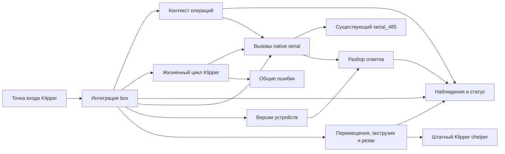

# Архитектура

[English](architecture.md) | Русский

**Статус:** состояние, настройки, хранение, интеграция native-вызовов, разбор ответов
и версии отдельных устройств реализованы с тестами на ПК. Жизненный цикл,
кооперативный контекст операций, общие ошибки и настроенные механические действия
также проверяются на ПК, как и компоненты drain/refill, восстановления и resume
этапа 8. Загрузчик запускает пассивный допуск без механических действий хоста;
аппаратная приёмка ещё предстоит. Этап 9
добавляет синтетические проверки Jinja/границ сохранённых модулей и обратимое
размещение файлов для разработки.

## Область работы

Заменяем штатный модуль Klipper `[box]` на K1C с CFS Upgrade, сохраняя существующую
хостовую библиотеку `serial_485` и прошивку MCU CFS. Сохраняем экран, Creality Print,
статус Fluidd, маппинг слайсера и пользовательские настройки. Объём включает
инициализацию, загрузку, выгрузку, резку, смену и продувку, паузу/продолжение,
ошибки/восстановление, датчики, RFID и данные катушек.

## Структура и ответственность

| Путь | Ответственность | Текущее состояние |
| --- | --- | --- |
| `klipper/box.py` | Тонкая точка входа Klipper | Импортирует пассивный загрузчик |
| `src/cfs/box.py` | Общие данные, endpoint, статус, metadata hook и интеграция обработчиков | Проверены на ПК инициализация, допуск typed-чтений и блокировки действий хоста |
| `src/cfs/state.py` | Общее live-состояние, снимки, отображения и группировка | Реализовано; разобранные наблюдения поступают в это состояние |
| `src/cfs/configuration.py` | Загрузчик, UI-значения и MODIFY/SAVE | Реализовано с явными правилами сохранения |
| `src/cfs/storage.py` | Кэш катушек, recovery hints и чтение базы материалов | Реализовано; восстановление использует проверенные подсказки |
| `src/cfs/native.py` | Тела запросов, проверка ответов и вызовы заимствованного native API | Точные тела, таймауты, sender-повторы и фильтры допуска проверены на ПК |
| `src/cfs/protocol.py` | Разбор команд/статусов и упорядоченные эффекты | Общие ошибки и эффекты slot/refill/drain подключены; проверки с подстановками на ПК |
| `src/cfs/events.py`, `runout.py`, `recovery.py`, `resume.py` | События слотов, drain/refill, восстановление и resume | Проверки с подстановками; физическое поведение не проверено |
| `src/cfs/firmware.py` | Идентичность каждого адреса, явное семейство и точные профили версий | Разные версии и сброс идентичности проверены на ПК |
| `src/cfs/lifecycle.py` | Ready/shutdown, настроенные зависимости, reconnect, heartbeat и ожидание паузы | Собственные действия снимаются или инвалидируются; транспорт остаётся штатному serial |
| `src/cfs/operations.py` | Владение source/target, кооперативные ожидания и результат head-callback | Обязательные callbacks фаз, адресное отключение heartbeat и отмена проверены на ПК |
| `src/cfs/errors.py` | Клиентские сообщения, порядок pause/restore и контекст ошибки | Повторы/специальные ключи и выходы после перехвата ошибок проверены на ПК |
| `src/cfs/motion.py`, `extrusion.py`, `cutting.py` | Настроенные движения, вентиляторы, нагрев, подача, резка и калибровка | Компонентные проверки на подстановках; аппаратная приёмка впереди |
| `src/cfs/feeding.py`, `loading.py`, `retraction.py` | Предзагрузка, поэтапная загрузка и выгрузка | Проверки фаз на ПК; аппаратная приёмка впереди |
| `tests/test_box_contract.py` | Размещение Klipper и проверки внешнего контракта | Только проверка загрузчика и размещения |
| `tests/test_contract_matrix.py` | Полнота перечня и связи с проверками | Проверяет реальные ссылки на тесты и оставшуюся работу |
| `tests/test_state.py`, `test_configuration.py`, `test_storage.py`, `test_box_data.py` | Сценарии компонентов и команд данных | Синтетические значения, временные файлы, ограниченные подстановки Klipper |
| `tests/test_native.py`, `test_protocol.py`, `test_firmware.py`, `test_box_native.py` | Сценарии native-границы, разбора, идентичности и интеграции | Синтетические кадры, подстановки заимствованного API и reactor |
| `tests/test_lifecycle.py`, `test_operations.py`, `test_errors.py` | Жизненный цикл, владение операцией и сообщения | Управляемый кооперативный reactor, native-ответы, ожидания и callbacks |
| `tests/test_motion.py`, `test_extrusion.py`, `test_cutting.py`, `test_host_actions.py` | Действия хоста, их регистрация и интеграция | Синтетический G-code, нагреватели, вентиляторы, кнопки и ответы колеса; без оборудования |
| `docs/contract-matrix.json` | Полный перечень реализации и приёмочных сценариев | Статус реализации требований и семейств проверок |
| `docs/` | Архитектура, протокол и совместимость на двух языках | Черновые спецификации |

Модули выделяются, когда реализованному поведению нужно разделение, вместе с тестами.
Диаграмма показывает ответственность компонентов; составные смены инструмента
проверены на ПК, аппаратная приёмка ещё предстоит.

## Владение и зависимости

Штатный serial-объект владеет UART, жизненным циклом соединения, приёмом и своими
внутренними повторами. Расширение получает этот объект через Klipper.
Оно не должно открывать порт, подменять native-приём, закрывать чужое соединение
или добавлять ещё один цикл транспортных повторов. Адаптер сохраняет восстановленные
повторы box по статусам CRC/длины через этот API. Доступный API и его ограничения
описаны в [документе протокола](protocol.ru.md#native-api).

Native-привязка использует только настроенный bus. У каждого адреса свои
идентичность и известный профиль прошивки; ответ с версией сам по себе не определяет
семейство оборудования. Поколения привязки/устройства отклоняют устаревшие действия
до следующих вызовов native API и между эффектами. Они не отменяют повторы, уже
выполняемые внутри штатного модуля. Эффектам ошибок, событий и операций нужны
реальные обработчики; при их отсутствии возникает исключение. См.
[границы интеграции](protocol.ru.md#native-integration).

Регистрация жизненного цикла предшествует макро-алиасам на connect. Ready получает
настроенные зависимости, отправляет `box:ready`, затем планирует собственный heartbeat.
Shutdown снимает свои таймеры и отложенные callbacks данных и отменяет владение
операцией. Постоянные подписки событий принтера остаются закрытыми во время остановки.
До startup нужны актуальная идентичность адреса и внешний контекст семейства;
позднее подтверждение семейства/версии заново запускает инициализацию. См.
[правила жизненного цикла и оставшиеся привязки фаз](protocol.ru.md#lifecycle-integration).

Рабочий путь `load_config` требует сохранённый `extras.base_info.base_dir`,
загружает настроенную секцию `serial_485 <bus>` средствами Klipper и регистрирует
пассивный жизненный цикл. Для адресов 1–4 явно задан целевой контекст `cfs0`;
ответ identity не определяет семейство оборудования. Пассивный запуск сохраняет
разбор identity/телеметрии и подавляет автоматическую предзагрузку, команды
моторов, переключение датчиков, паузу, нагрев и подтягивание. Действия хоста
отклоняются до входа в их обработчики. Настройки для включения активных маршрутов
компонентов нет. В [руководстве установки](installation.ru.md#passive-startup)
перечислены зависимости, пути данных и разрешённые запросы чтения.

Операции согласуют действия хоста с отдельными наблюдениями CFS, буфера и головы.
ACK, последняя T-команда или сохранённый материал не доказывают физическое
завершение загрузки. Неизвестные наблюдения остаются неизвестными.

Оставшиеся Python-модули также используют отдельные атрибуты `box` и metadata
hook. Эти пути перечислены в [матрице контракта](contract-matrix.ru.md) и связаны
с рабочим состоянием. Их совместимость не требует прежней иерархии классов.
Отложенная цель принадлежит `virtual_sdcard.resume_tnn`.

Ожидания должны позволять Klipper reactor продолжать работу. Таймаут транзакции,
общий срок операции и подтверждённая политика восстановления имеют разный смысл.
Их конкретные значения и переходы берём из штатной реализации нужной версии.

## Размещение Klipper и Python

[Установщик для разработки](installation.ru.md) размещает `klippy/extras/box.py`
и `klippy/extras/cfs/`, поддерживая просмотр, ограниченную копию и откат. Тесты
во временных деревьях проверяют импорт и пассивную инициализацию. Другие модули,
настройки, службы и данные катушек остаются у своих владельцев; принтер не менялся.

Python 3.8 закреплён в [.python-version](../.python-version) и соответствует
базовому ABI CPython без подтверждения совместимости native MIPS. Тесты рабочей
копии используют `unittest` и тестовый Jinja2 3.1.6 из `requirements-test.txt`;
CI устанавливает эти зависимости. Публичные примеры синтетические. Локальное
исполнение закреплённых сохранённых исходников — отдельное свидетельство.
Точка входа runtime — Klipper `load_config(config)` с блокировкой механики для допуска.

## Конфигурация и сохранённые данные

Используем рабочую конфигурацию, включая координаты, температурные обёртки
и переименованные G-code команды. Длины загрузки и продувки читаем из настроек;
значения одного принтера не превращаем в общие значения по умолчанию. Сохраняем
данные катушек, базы материалов и маппинг слайсера. Изменения хранения требуют
отдельно проверенного формата и поведения при отказе; нового хранилища здесь нет.

В этой структуре размещаются публичные исходники и синтетические тесты. Оригиналы,
захваты, бинарный анализ и настройки конкретной машины остаются в игнорируемом
локальном каталоге. Матрица ссылается на разрешённые официальные заводские
источники. Остальные исследовательские ссылки на этом этапе остаются приватными.

## Подход к реализации

Используем [матрицу полного контракта](contract-matrix.ru.md), включая
зависимости от native serial API и существующих макросов. Для каждой
операции описываем предварительные условия, команды, наблюдения, ожидания,
завершение и отказы. Реализуем и проверяем небольшие части этого контракта,
сохраняя полный объём проекта. На ПК проверяем порядок действий, отсутствие
показаний, таймауты и отрицательные ответы. Аппаратная приёмка — отдельный этап,
требующий разрешения.

Состояние реализации и доказательств отражается в
[compatibility.ru.md](compatibility.ru.md).
Порядок этапов и критерии готовности полного контракта определяет
[план реализации](implementation-plan.ru.md).
