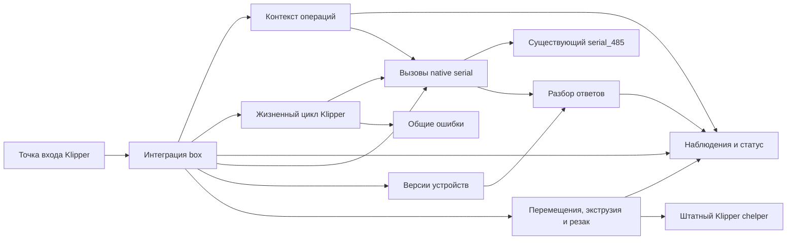

# Архитектура

[English](architecture.md) | Русский

Расширение использует штатный `serial_485.so` в рабочем и пассивном режимах.
На одном K1C с CFS Upgrade и MCU 1.1.3 выполнены смены инструмента и двухцветные
задания, включая паузу и продолжение. Трёхцветное задание из OrcaSlicer
завершилось после ручного восстановления подачи. Путь Retry после ошибки смены
проверен на ПК, сборка с ним запущена на принтере. [Совместимость](compatibility.ru.md)
отделяет эти результаты от оставшихся аппаратных проверок.

## Область работы

Заменяем штатный модуль Klipper `[box]` на K1C с CFS Upgrade, сохраняя существующую
хостовую библиотеку `serial_485` и прошивку MCU CFS. Сохраняем экран, Creality Print,
статус Fluidd, маппинг слайсера и пользовательские настройки. Объём включает
инициализацию, загрузку, выгрузку, резку, смену и продувку, паузу/продолжение,
ошибки/восстановление, датчики, RFID и данные катушек.

## Структура и ответственность

| Путь | Ответственность | Текущее состояние |
| --- | --- | --- |
| `klipper/box.py` | Тонкая точка входа Klipper | Выбирает рабочий или пассивный режим |
| `src/cfs/box.py` | Общие данные, endpoint, статус, metadata hook и интеграция обработчиков | Обычные команды и отдельные диагностические операции |
| `src/cfs/state.py` | Общее live-состояние, снимки, отображения и группировка | Реализовано; разобранные наблюдения поступают в это состояние |
| `src/cfs/configuration.py` | Загрузчик, UI-значения и MODIFY/SAVE | Реализовано с явными правилами сохранения |
| `src/cfs/storage.py` | Кэш катушек, recovery hints и чтение базы материалов | Реализовано; восстановление использует проверенные подсказки |
| `src/cfs/native.py` | Тела запросов, проверка ответов и вызовы заимствованного native API | Тела/повторы на ПК и ограниченные обычные базовые наблюдения возвратов API |
| `src/cfs/protocol.py` | Разбор команд/статусов и упорядоченные эффекты | Разбор проверен на ПК, обмен базовой версии записан на принтере |
| `src/cfs/events.py`, `runout.py`, `recovery.py`, `resume.py` | События слотов, выдавливание остатка, дозаправка и восстановление | События слотов, пауза и продолжение наблюдались на 1.1.3. Автоматический повтор и дозаправка проверены на ПК |
| `src/cfs/firmware.py` | Идентичность каждого адреса, явное семейство и точные профили версий | Разные версии и сброс идентичности проверены на ПК |
| `src/cfs/lifecycle.py` | Ready/shutdown, настроенные зависимости, reconnect, heartbeat и ожидание паузы | Собственные действия снимаются или инвалидируются; транспорт остаётся штатному serial |
| `src/cfs/operations.py` | Владение source/target, кооперативные ожидания, результат head-callback и явные пробы | Проверки на ПК, предзагрузка T1A–T1D и два полных последовательных цикла T1C |
| `src/cfs/print_trial.py` | Один разрешённый файл, virtual-SD worker и конечные контексты событий/управления | Проба с одним файлом в пассивном режиме проверена на ПК |
| `src/cfs/errors.py` | Клиентские сообщения, порядок pause/restore и контекст ошибки | Повторы/специальные ключи и выходы после перехвата ошибок проверены на ПК |
| `src/cfs/motion.py`, `extrusion.py`, `cutting.py` | Настроенные движения, вентиляторы, нагрев, подача, резка и калибровка | Проверки на ПК и проверенный маршрут загрузки/выгрузки T1C |
| `src/cfs/feeding.py`, `loading.py`, `retraction.py` | Предзагрузка, поэтапная загрузка и выгрузка | Проверки фаз на ПК и явных базовых операций предзагрузки/загрузки/выгрузки |
| `tests/test_box_contract.py` | Размещение Klipper и проверки внешнего контракта | Только проверка загрузчика и размещения |
| `tests/test_contract_matrix.py` | Полнота перечня и связи с проверками | Проверяет реальные ссылки на тесты и оставшуюся работу |
| `tests/test_state.py`, `test_configuration.py`, `test_storage.py`, `test_box_data.py` | Сценарии компонентов и команд данных | Синтетические значения, временные файлы, ограниченные подстановки Klipper |
| `tests/test_native.py`, `test_protocol.py`, `test_firmware.py`, `test_box_native.py` | Сценарии native-границы, разбора, идентичности и интеграции | Синтетические кадры, подстановки заимствованного API и reactor |
| `tests/test_lifecycle.py`, `test_operations.py`, `test_errors.py` | Жизненный цикл, владение операцией и сообщения | Управляемый кооперативный reactor, native-ответы, ожидания и callbacks |
| `tests/test_motion.py`, `test_extrusion.py`, `test_cutting.py`, `test_host_actions.py` | Действия хоста, их регистрация и интеграция | Синтетический G-code, нагреватели, вентиляторы, кнопки и ответы колеса; без оборудования |
| `tests/test_material_workflow.py` | Полные циклы загрузки/выгрузки в порядке сервиса | Общее изменяющееся состояние XYZ/E/источника, штатные по форме макроалиасы, ответы и внесённые отказы |
| `tests/test_toolchange_trial.py`, `test_print_trial.py`, `test_print_integration.py` | Ограниченные пробы, рабочая печать и Retry после паузы | Синтетические native-ответы, настоящие зарегистрированные обработчики и границы штатного worker |
| `docs/contract-matrix.json` | Полный перечень реализации и приёмочных сценариев | Статус реализации требований и семейств проверок |
| `docs/` | Архитектура, протокол и совместимость на двух языках | Текущее поведение и границы проверки |

Модули выделяются, когда реализованному поведению нужно разделение, вместе с тестами.
Диаграмма показывает ответственность компонентов.

## Владение и зависимости

Штатный serial-объект владеет UART, жизненным циклом соединения, приёмом и своими
внутренними повторами. Расширение получает этот объект через Klipper.
Оно не должно открывать порт, подменять native-приём, закрывать чужое соединение
или добавлять ещё один цикл транспортных повторов. Адаптер сохраняет восстановленные
повторы box по статусам CRC/длины через этот API. Доступный API и его ограничения
описаны в [документе протокола](protocol.ru.md#native-api).

Native-привязка использует только настроенный bus. У каждого адреса свои
идентичность и известный профиль прошивки; ответ с версией сам по себе не определяет
семейство оборудования. Поколения привязки/устройства отклоняют устаревшие действия
до следующих вызовов native API и между эффектами. Они не отменяют повторы, уже
выполняемые внутри штатного модуля. Эффектам ошибок, событий и операций нужны
реальные обработчики; при их отсутствии возникает исключение. См.
[границы интеграции](protocol.ru.md#native-integration).

Регистрация жизненного цикла предшествует макро-алиасам на connect. Ready получает
настроенные зависимости, отправляет `box:ready`, затем планирует собственный heartbeat.
Shutdown снимает свои таймеры и отложенные callbacks данных и отменяет владение
операцией. Постоянные подписки событий принтера остаются закрытыми во время остановки.
До startup нужны актуальная идентичность адреса и внешний контекст семейства;
позднее подтверждение семейства/версии заново запускает инициализацию. См.
[правила жизненного цикла](protocol.ru.md#lifecycle-integration).

Рабочий путь `load_config` требует сохранённый `extras.base_info.base_dir`,
загружает настроенную секцию `serial_485 <bus>` средствами Klipper и регистрирует
рабочий жизненный цикл. Для адресов 1–4 явно задан целевой контекст `cfs0`.
Пассивный режим сохраняет
разбор identity/телеметрии и подавляет автоматическую предзагрузку, команды
моторов, переключение датчиков, паузу, нагрев и подтягивание вне отдельных проб. В
[руководстве установки](installation.ru.md#passive-startup)
перечислены зависимости, пути данных и разрешённые запросы чтения.

Явные команды [предзагрузки](installation.ru.md#single-operation-trial) и
[загрузки/выгрузки](installation.ru.md#material-operation-trial) дают допуск
только текущей операции, сохраняя пассивный жизненный цикл. Проба материала
исполняет настроенный рецепт с очисткой, продувкой и возвратом позиции.
Зарегистрированные команды фаз доступны сохранённым клиентам и отдельно.
Владение контекстом и свежие начальные/конечные показания закрепляют выбранный
источник; ненормальная фаза отзывает допуск до следующих эффектов.

[Проба смены](installation.ru.md#tool-change-trial) использует зарегистрированный
координатор и рассчитанную продувку. [Допуск печати](installation.ru.md#print-trial)
закрепляет один файл и настоящий virtual-SD worker, с привязанными к token
контекстами callbacks и управления для pause/resume и настоящих событий runout.
Обе пробы требуют пассивного режима. Проверка `START_PRINT` определяет первый
инструмент файла в обоих режимах. Обычная печать использует сопоставленные слоты
и штатный virtual-SD worker. Пассивная проба также проверяет допуск файла и worker.

После остановки на загрузке инструмента virtual SD сохраняются открытый файл,
смещение продолжения и сопоставленный слот. `BOX_ERROR_CLEAR` сохраняет этот
контекст. Retry проверяет наличие материала в слоте и использует существующие
фазы подачи и продувки. Перед продолжением должны совпасть выбранный инструмент
и сохранённая цель, а датчик в голове должен подтвердить наличие материала.

Владеющая LOAD задаёт ограниченную положительную длину продувки из конфигурации.
Владеющая UNLOAD известного источника отправляет конечное втягивание головы
перед MATERIAL и ожидает его после обычного ACK, до очистки источника и возврата
XYZ. На MCU 1.1.3 выполнены два полных последовательных цикла T1C без ручной помощи.

UNLOAD неизвестного источника использует существующую ветку Retraction без
присваивания загруженного источника. Запрошенный слот закрепляет один свежий
канал хаба; его текущая команда владеет упорядоченными чтениями, IDLE, общим
BUFFER и выбранным MATERIAL с одним обычным ответом на шаг и конечной проверкой
датчиков.

Операции согласуют действия хоста с отдельными наблюдениями CFS, буфера и головы.
ACK, последняя T-команда или сохранённый материал не доказывают физическое
завершение загрузки. Обычное поле режима не является отдельным признаком занятости
FSM предзагрузки; даже ACK с режимом `0` требует независимого физического
наблюдения. Неизвестные наблюдения остаются неизвестными.

Оставшиеся Python-модули также используют отдельные атрибуты `box` и metadata
hook. Эти пути перечислены в [матрице контракта](contract-matrix.ru.md) и связаны
с рабочим состоянием. Их совместимость не требует прежней иерархии классов.
Отложенная цель принадлежит `virtual_sdcard.resume_tnn`.

Ожидания должны позволять Klipper reactor продолжать работу. Таймаут транзакции,
общий срок операции и подтверждённая политика восстановления имеют разный смысл.
Их конкретные значения и переходы берём из штатной реализации нужной версии.

## Размещение Klipper и Python

[Установщик](installation.ru.md) размещает `klippy/extras/box.py`
и `klippy/extras/cfs/`, поддерживая просмотр, ограниченную копию и откат. Тесты
во временных деревьях проверяют импорт и режимы запуска. Другие модули,
настройки, службы и данные катушек остаются у своих владельцев. Команды и текущие
проверки описаны в [руководстве установки](installation.ru.md).

Python 3.8 закреплён в [.python-version](../.python-version) и соответствует
базовому ABI CPython без подтверждения совместимости native MIPS. Тесты рабочей
копии используют `unittest` и тестовый Jinja2 3.1.6 из `requirements-test.txt`;
CI устанавливает эти зависимости. Публичные примеры синтетические. Локальное
исполнение закреплённых сохранённых исходников — отдельное свидетельство.
Точка входа Klipper — `load_config(config)`. По умолчанию включён рабочий режим.
Для диагностического запуска задайте `passive: true` в `[box]`.

## Конфигурация и сохранённые данные

Используем рабочую конфигурацию, включая координаты, температурные обёртки
и переименованные G-code команды. Длины загрузки и продувки читаем из настроек;
значения одного принтера не превращаем в общие значения по умолчанию. Сохраняем
данные катушек, базы материалов и маппинг слайсера. Изменения хранения требуют
отдельно проверенного формата и поведения при отказе; нового хранилища здесь нет.

В этой структуре размещаются публичные исходники и синтетические тесты. Оригиналы,
захваты, бинарный анализ и настройки конкретной машины остаются в игнорируемом
локальном каталоге. Матрица ссылается на разрешённые официальные заводские
источники. Остальные исследовательские ссылки на этом этапе остаются приватными.

## Подход к реализации

[Матрица контракта](contract-matrix.ru.md) описывает условия, команды,
наблюдения, завершение и отказы, включая зависимости от native serial API и
штатных макросов. Тесты на ПК проверяют порядок действий, отсутствие показаний,
таймауты и отрицательные ответы. [План проверок](implementation-plan.ru.md)
фиксирует результаты контрольного принтера и оставшиеся аппаратные сценарии.
