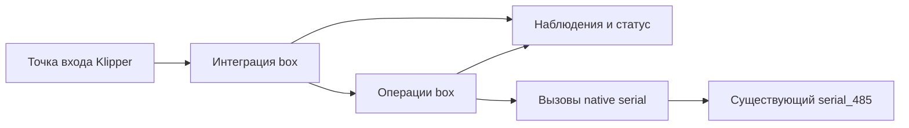

# Архитектура

[English](architecture.md) | Русский

**Статус:** согласованная структура разработки. Реализованы только отказ
загрузчика от активации и проверка размещения на ПК; операции CFS не реализованы.

## Область работы

Заменяем штатный модуль Klipper `[box]` на K1C с CFS Upgrade, сохраняя существующую
хостовую библиотеку `serial_485` и прошивку MCU CFS. Сохраняем экран, Creality Print,
статус Fluidd, маппинг слайсера и пользовательские настройки. Объём включает
инициализацию, загрузку, выгрузку, резку, смену и продувку, паузу/продолжение,
ошибки/восстановление, датчики, RFID и данные катушек.

## Структура и ответственность

| Путь | Ответственность | Текущее состояние |
| --- | --- | --- |
| `klipper/box.py` | Тонкая точка входа Klipper | Импортирует загрузчик; активация отклоняется |
| `src/cfs_box/box.py` | Конфигурация, жизненный цикл, регистрация G-code, датчики, `get_status()` | Только отказ от активации |
| `tests/test_box_contract.py` | Размещение Klipper и проверки внешнего контракта | Только проверка загрузчика и размещения |
| `docs/` | Архитектура, протокол и совместимость на двух языках | Черновые спецификации |

Модули операций, native-вызовов и состояния выделяются, когда подтверждённому
поведению нужен отдельный модуль, вместе с проверяющими его тестами и синтетическими
примерами. Диаграмма ниже показывает логическую ответственность, а не готовые файлы.

## Владение и зависимости

Штатный serial-объект владеет UART, жизненным циклом соединения, приёмом и своими
внутренними повторами. Расширение получает этот объект через Klipper.
Оно не должно открывать порт, подменять native-приём, закрывать чужое соединение
или добавлять ещё один цикл транспортных повторов. Доступный API и его ограничения
описаны в [документе протокола](protocol.ru.md#native-api).

Операции согласуют действия хоста с отдельными наблюдениями CFS, буфера и головы.
ACK, последняя T-команда или сохранённый материал не доказывают физическое
завершение загрузки. Неизвестные наблюдения остаются неизвестными.

Ожидания должны позволять Klipper reactor продолжать работу. Таймаут транзакции,
общий срок операции и подтверждённая политика восстановления имеют разный смысл.
Их конкретные значения и переходы берём из штатной реализации нужной версии.

## Размещение Klipper и Python

Планируемое размещение: `klippy/extras/box.py` и `klippy/extras/cfs_box/`.
Тест на ПК проверяет такой импорт и явный отказ каркаса от активации. Установщика
пока нет.

Исходники рассчитаны на Python 3.8 или новее, в соответствии
с базовым ABI CPython 3.8 сохранённого native-модуля. Тесты на более новом Python
на ПК не подтверждают совместимость ABI или работу на принтере. Тесты запускаются
прямо из рабочей копии стандартным `unittest`. CI запускает их на Python 3.8 и 3.11
без установки и сборки пакетов. Расширение загружает Klipper; исходники и точка
входа будут размещаться напрямую отдельно проверенным обратимым способом установки.

Прежний демонстрационный CLI удалён. Точка входа времени выполнения —
`load_config(config)` со стороны Klipper.

## Конфигурация и сохранённые данные

Используем рабочую конфигурацию, включая координаты, температурные обёртки
и переименованные G-code команды. Длины загрузки и продувки читаем из настроек;
значения одного принтера не превращаем в общие значения по умолчанию. Сохраняем
данные катушек, базы материалов и маппинг слайсера. Изменения хранения требуют
отдельно проверенного формата и поведения при отказе; нового хранилища здесь нет.

В этой структуре размещаются публичные исходники и синтетические тесты. Оригиналы,
захваты, бинарный анализ и настройки конкретной машины остаются в игнорируемом
локальном каталоге. Ссылки на внешние исследования на этом этапе не включаются
в публичную документацию.

## Подход к реализации

Восстанавливаем полный перечень штатных команд, жизненный цикл и состояния,
включая зависимости от native serial API и существующих макросов. Для каждой
операции описываем предварительные условия, команды, наблюдения, ожидания,
завершение и отказы. Реализуем и проверяем небольшие части этого контракта,
сохраняя полный объём проекта. На ПК проверяем порядок действий, отсутствие
показаний, таймауты и отрицательные ответы. Аппаратная приёмка — отдельный этап,
требующий разрешения.

Состояние реализации и доказательств отражается в
[compatibility.ru.md](compatibility.ru.md).
